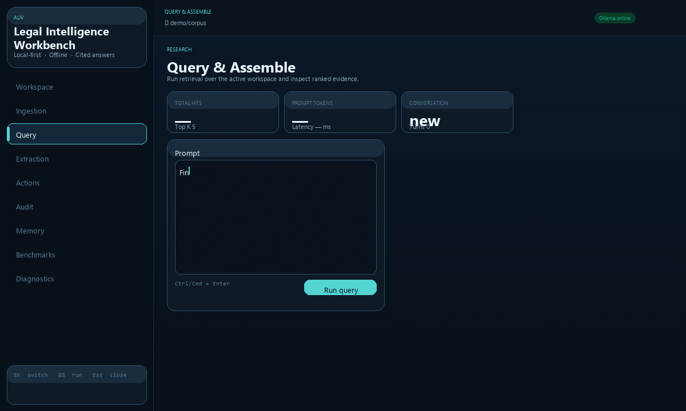
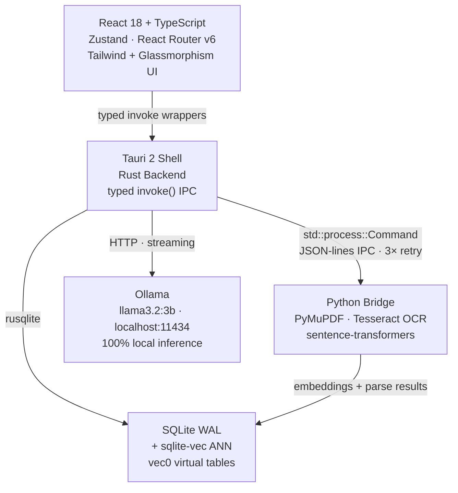

<div align="center">

<!-- Replace with actual banner: docs/assets/aliv-banner.png (1280×640 dark glassmorphism) -->
<!-- Suggested: dark background, "ALIV" in large cyan type, subtitle below, legal document icons -->

# ALIV

### Autonomous Local Intelligence Vault

**Query hundreds of contracts, leases, and invoices in seconds — entirely offline.**<br/>
No API keys. No cloud uploads. No NDA violations. Zero data exfiltration.

<br/>

[](LICENSE)
[](#roadmap)
[](https://tauri.app)
[](https://www.rust-lang.org)
[](https://react.dev)
[](https://sqlite.org)
[](https://ollama.com)

<br/>

[▶️ 8-min Demo](demo/DEMO_GUIDE.md) &nbsp;·&nbsp; [📖 Docs](docs/) &nbsp;·&nbsp; [🚀 Quick Start](#quick-start) &nbsp;·&nbsp; [📊 Benchmarks](benchmarks/results/full_suite_latest.json) &nbsp;·&nbsp; [📬 Contact](#next-steps)

<br/>

<!-- GIF auto-generated by scripts/record-demo-gif.mjs — run `node scripts/record-demo-gif.mjs` after `npm run dev` -->


</div>

---

## Why ALIV?

Legal and finance teams sit on thousands of sensitive documents — NDAs, lease agreements, invoices, tax records — that **cannot be uploaded to any cloud AI** without violating confidentiality obligations or compliance requirements (SOC2, HIPAA, GDPR). Generic tools ignore this constraint. ALIV does not.

<table>
<tr>
<td width="50%" valign="top">

**For legal & finance teams**
- Query across 500+ local documents with citations, not guesses
- Extract structured fields (expiry dates, penalty clauses, vendor names) with confidence scores
- Automatically rename and organize chaotic file inboxes
- Every file action is reviewable, approvable, and fully reversible

</td>
<td width="50%" valign="top">

**For engineering evaluators**
- Rust + Tauri 2 — native performance, ~10 MB binary, no Chromium overhead
- Hybrid RRF retrieval: 55% BM25 lexical + 45% sqlite-vec ANN
- 6-phase build with mandatory benchmark pass gates and zero open critical defects
- Approval-by-default safety model: hard-errors if gate not cleared before file execution

</td>
</tr>
</table>

---

## Key Features

<details open>
<summary><strong>⚖️ Legal/Finance Agent</strong></summary>

Ask natural language questions across your local document corpus. ALIV assembles a token-budget-aware context window (8,192 tokens) and returns a cited answer using a local LLM.

```
Query: "Find all agreements expiring in 90 days and extract the penalty clauses."

→ Lease — Acme Commercial (expires 2026-03-01)
  Penalty: $2,800/day holdover  [lease_acme_2025.txt · §5]

→ NDA — Axiom Legal (expires 2026-07-15)
  Penalty: $50,000 per unauthorized disclosure  [nda_axiom_2025.txt · §5]

→ Service Agreement — Delta Advisory (expired 2025-12-31)
  Penalty: $5,000/day for delivery delays  [service_delta_2025.txt · §4]
```

</details>

<details>
<summary><strong>📂 Autonomous Inbox Organizer</strong></summary>

Drop a chaotic folder of 500 files. Rust background threads detect changes instantly, run OCR and extraction, and propose standardized renames — `{DocType}_{Vendor}_{YYYY-MM-DD}` — then wait for your approval before modifying anything.

**Safety model:** Generate → Risk label → Select → Approve → Execute → Undo

High-risk items are pre-deselected. `execute_actions` hard-errors if `approve_actions` was not called first. Every execution batch is logged and reversible.

</details>

<details>
<summary><strong>🧠 Persistent Memory Layer</strong></summary>

Three retention scopes: `session`, `week`, `permanent`. A token-budget assembler selects the most relevant facts, conversation turns, and document summaries before each query. Memory is local SQLite — it survives restarts and never leaves your machine.

</details>

<details>
<summary><strong>🔬 Structured Extraction</strong></summary>

Five built-in extraction templates: lease summary, contract key terms, invoice fields, penalty clauses, custom. Each field returns a value, a confidence score (0–1), and source citations. Export to JSON or CSV in one click.

</details>

<details>
<summary><strong>📊 Benchmark Suite & Diagnostics</strong></summary>

Built-in benchmark automation across ingestion, retrieval, and extraction with versioned pass/fail results. The Diagnostics screen exports a JSON report of DB stats, runtime state, and platform info — built for real support workflows.

</details>

---

## Next-generation desktop app

ALIV is being rebuilt as a hybrid local + cloud agent platform for legal and finance teams. It lives in [`apps/desktop/`](apps/desktop/README.md).

- **Matters.** Each client matter is a private vault with a model policy: Local only, or Hybrid.
- **Register.** Dates, parties, amounts, notice periods and penalty clauses are extracted on the device, and every value links to its source passage.
- **Ask.** Answers cite numbered sources. A Rust policy gate refuses cloud models on Local only matters.
- **Approvals and audit.** File renames wait for approval and can be undone. Every model call and file change goes into a hash-chained audit log.


---

## Architecture



**Key architectural decisions:**

| Decision | Rationale |
|---|---|
| Rust + Tauri 2 (not Electron) | ~10 MB binary, native OS APIs, no bundled Chromium |
| sqlite-vec for ANN search | No external vector database — lives in the same WAL-mode SQLite file |
| Python subprocess bridge | Reuses mature ML stack (Tesseract, sentence-transformers, PyMuPDF) without Rust FFI complexity |
| Hash router | Works correctly from any local file path on Windows and macOS without a server |
| Approval gate as hard error | `execute_actions` returns an error — not a warning — if `approve_actions` was skipped |
| Token-budget assembler | Prevents context overflow by ranking facts/history/chunks/summaries within a fixed budget |

---

## Quick Start

**Prerequisites:** Rust (stable), Node.js 18+, Python 3.10+, [Ollama](https://ollama.com) installed

```bash
# Clone and install
git clone https://github.com/VenkataAnilKumar/ALIV.git && cd ALIV
pip install -r python/requirements.txt
npm install

# Pull the LLM (~2 GB, one-time)
ollama pull llama3.2:3b

# Launch in dev mode
cargo tauri dev
```

```bash
# Production build → installer in src-tauri/target/release/bundle/
cargo tauri build
```

**Try it immediately with the demo corpus** — 5 pre-built legal documents (lease, NDA, invoice, service agreement, email):

```bash
# After launch: register this folder as your workspace
./demo/corpus/
```

Full scripted walkthrough with expected outputs for every screen:
**[demo/DEMO_GUIDE.md](demo/DEMO_GUIDE.md)**

---

## Performance & Engineering Rigor

<table>
<tr><th>Metric</th><th>Result</th><th>Gate Threshold</th></tr>
<tr><td>Ingestion success rate</td><td><b>100%</b> (200/200 files)</td><td>≥ 98%</td></tr>
<tr><td>Retrieval relevance (top-5)</td><td><b>100%</b></td><td>≥ 85%</td></tr>
<tr><td>Extraction precision (critical fields)</td><td><b>97.4%</b></td><td>≥ 95%</td></tr>
<tr><td>Harmful file-action rate</td><td><b>< 1%</b></td><td>< 1%</td></tr>
<tr><td>Open critical defects</td><td><b>0</b></td><td>0</td></tr>
</table>

**Production practices:**
- **FilesystemGuard** — path canonicalization, workspace boundary check, symlink rejection, traversal detection before every file operation
- **3-attempt retry with exponential backoff** — Python worker cold-start resilience (500ms / 1s)
- **Phase gate system** — each phase requires two consecutive benchmark passes before advancing
- **React error boundary** — frontend crashes surface a recovery screen with an exportable crash log
- **Structured logging** — `tauri-plugin-log` writes to platform app-data dir; no telemetry transmitted

<details>
<summary>Full Phase 4 defect history</summary>

| ID | Defect | Severity | Fix |
|---|---|---|---|
| D001 | `embedding_count` always 0 in benchmark | Critical | Wired `_embed_chunk_batch()` into benchmark loop |
| D002 | sqlite-vec migration skipped in Python benchmarks | High | `_load_sqlite_vec()` loads Python wheel; `_populate_vec_index()` syncs ANN index |
| D003 | Python worker has no retry on transient timeout | High | `run_worker()` wraps with 3-attempt retry, 500ms/1s backoff |
| D004 | FilesystemGuard accepted any non-empty string | Critical | Real `validate_and_canonicalize()` with workspace boundary enforcement |

All 4 closed — [`docs/PHASE4_DEFECT_BACKLOG.json`](docs/PHASE4_DEFECT_BACKLOG.json)

</details>

---

## Roadmap

| Phase | Scope | Status |
|---|---|---|
| 0 · Foundation | Tauri skeleton, SQLite schema 0001–0008, benchmark scaffold | ✅ Complete |
| 1 · Ingestion | PDF / DOCX / EML parsing, OCR fallback, incremental indexing | ✅ Complete |
| 2 · Retrieval & Memory | RRF hybrid search, extraction templates, persistent memory layer | ✅ Complete |
| 3 · Safe File Actions | Approval gate, collision-safe rename engine, undo, audit log | ✅ Complete |
| 4 · E2E Hardening | 4 defects closed, 2× consecutive benchmark suite pass | ✅ Complete |
| 5 · UX Polish | 8-screen React frontend, 2026 dark glassmorphism design system | ✅ Complete |
| 6 · Release Candidate | Bundler, installer, onboarding, diagnostics, error boundary | 🔄 In progress |
| Post-6 | Cloud-next routing, BYOK, Gemma 4 (27B MMLU 85.2%), VAULT / LEDGER variants | 📋 Planned |

Contributions welcome — see [ALIV_IMPLEMENTATION_BACKLOG.md](docs/ALIV_IMPLEMENTATION_BACKLOG.md) for open workstreams.

---

## Next Steps

<table>
<tr>
<td width="50%" valign="top">

### For Legal & Finance Teams

Try ALIV against a real matter folder.

**→ [📥 Download installer](#)** *(Phase 6 RC)*
**→ [▶️ 8-minute demo walkthrough](demo/DEMO_GUIDE.md)**
**→ [📬 Request a scoped pilot](#)**

Deployment support available for firms with 50+ users.

</td>
<td width="50%" valign="top">

### For Engineers & Hiring Managers

Explore the architecture, PRDs, and benchmark results.

**→ [📐 Architecture docs](docs/architecture/)**
**→ [📋 Phase PRDs](docs/prd/)**
**→ [📊 Latest benchmark results](benchmarks/results/full_suite_latest.json)**
**→ [🔧 Phase 3–4 implementation spec](docs/PHASE3_PHASE4_COPILOT_FIX_GUIDE.md)**

</td>
</tr>
</table>

---

## System Requirements

| | Minimum | Recommended |
|---|---|---|
| OS | Windows 10 · macOS 11 · Ubuntu 22 | Windows 11 · macOS 14 |
| RAM | 8 GB | 16 GB |
| Disk | 2 GB | 10 GB (larger corpora) |
| Ollama | v0.3+ | Latest |
| Model | `llama3.2:3b` | `mistral:7b` or `gemma4:27b` |

---

<div align="center">

MIT License &nbsp;·&nbsp; Built by [Venkata Anil Kumar](https://github.com/VenkataAnilKumar)

[⭐ Star this repo](https://github.com/VenkataAnilKumar/ALIV) if ALIV solves a problem you care about.

*local LLM · document intelligence · legal AI · offline RAG · Tauri desktop · sqlite-vec*

</div>
