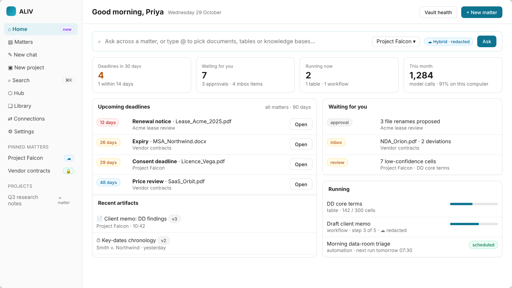

<div align="center">

# ALIV

### Audited Local Intelligence Vault

**The hybrid AI platform that keeps client matters on your machines.**<br/>
Cited answers, contract registers and audited AI for legal teams, and the finance work in their contracts. Local by default, cloud only when a matter's policy allows it.

<br/>

[](apps/desktop/LICENSE)
[](https://tauri.app)
[](https://www.rust-lang.org)
[](https://react.dev)
[](#status)

[Quick start](#quick-start) · [Features](#features) · [How it works](#how-it-works) · [Roadmap](#roadmap) · [Docs](#documentation)

<br/>


</div>

---

## Why ALIV

Cloud legal-AI platforms like Harvey and Legora have shown what AI can do for review, drafting and workflows, but they run in the vendor's cloud. Many firms, their clients and regulated finance teams can't send every confidential document there.

ALIV brings that kind of work to the firm's own hardware:

- **Private by default.** Each matter is a private vault on your computer. Documents are read in place, embeddings are computed locally, and new matters are *Local only*.
- **Hybrid by policy.** When a matter allows it, a cloud model can be used, but only the passages a question needs are sent, and every call is checked and logged.
- **Cited and in control.** Every answer and extracted value links to its source passage. File changes are proposals until you approve them, and can be undone.
- **Provable.** Every ingestion, policy change, model call and file action goes into a tamper-evident audit log you can verify.

## Features

### Available now

| | |
|---|---|
| 🗂️ **Matters** | One private vault per client engagement (Legal or Finance), each with a *Local only* or *Hybrid* model policy |
| 📥 **Ingestion** | PDF, DOCX, XLSX/XLS, PPTX, HTML, TXT/MD, CSV, RTF and EML, parsed on the device. Scans and images are read with OCR (Tesseract). Unchanged files are skipped on re-import |
| 🔎 **Hybrid search** | Keyword (SQLite FTS5) and meaning (local embeddings), fused, so "can we exit early?" finds a termination-for-convenience clause |
| 💬 **Ask** | Answers with numbered citations you can open. Large matters are trimmed to what fits the model, and the answer says how much was left out. Deadline questions are answered from the register, with no model |
| 📋 **Register** | Parties, dates, renewal-notice deadlines, amounts, notice periods, governing law and penalties, each with a confidence score and its source passage. CSV export is safe against spreadsheet formulas |
| 🛡️ **Policy gate** | Every model call in Ask is checked in Rust first. A cloud model on a *Local only* matter is refused, and the refusal is logged |
| ✅ **Approvals** | Proposed file renames never touch the disk until approved, never overwrite, and can be undone |
| 🔗 **Audit log** | SHA-256 hash chain with one-click integrity verification |
| 🩺 **Vault health** | A shareable report of counts and reasons, with no document text |
| 🤖 **Local models and CLI** | llama.cpp and MLX engines, plus the `aliv` command-line agent ([agent cookbook](apps/desktop/docs/agent/adk-cookbook.md)) |


### Also in the app (from the open-source base)

| | |
|---|---|
| ✎ **Chat and projects** | Free chat with local or cloud models; projects group chats with instructions |
| ⌕ **Search (⌘K)** | Search across chat threads |
| ⬡ **Hub** | Browse and download local models (GGUF) from Hugging Face |
| 🧩 **MCP and skills** | MCP client with OAuth; `SKILL.md` skills, skill-hub import and git plugins |
| 🌐 **Web search** | Built-in web search tool |
| 🗎 **Artifacts** | Rendered outputs from chats |

These work today **outside matter policy**. Keep client documents in a matter's Ask until R1 brings chat, web search, MCP and skills under the same policy check, redaction and audit (see [Status](#status)).

### Coming next

Model gateway and redaction · matter workspace (chats, instructions, folders) · governed skills, MCP and web search · review tables · workflows · playbooks with redlines · artifacts · layout-aware parsing and reranking · evaluation harness · connectors · automation · agent builder · Firm Server. See the [roadmap](#roadmap).



<sub>Mockup of the planned Home screen. More in the [Wireframes](docs/05-design/ALIV_Wireframes.md#high-fidelity-mockups).</sub>

## How it works

```
 Documents (stay where they are)
          │  parse · OCR · split into passages · extract fields · summarise
          ▼
 ┌──────────── Matter vault (SQLite, on your machine) ────────────┐
 │ passages + keyword index · local embeddings · register fields  │
 │ proposals · hash-chained audit log                             │
 └───────────────────────────┬────────────────────────────────────┘
                             │ hybrid search → cited sources
                             ▼
                  Ask ─▶ policy check (Rust) ─▶ local model (llama.cpp / MLX)
                                            └─▶ cloud model (Hybrid matters only, logged)
```

The app is a Tauri 2 desktop app: a Rust core with the matter-vault plugin, and a React 19 interface. See the [System Architecture](docs/06-technical/ALIV_System-Architecture.md) and [Hybrid AI Architecture](docs/06-technical/ALIV_Hybrid-AI-Architecture.md).

## Quick start

You need **Node 22** and **Rust** (the version is pinned in `apps/desktop/rust-toolchain.toml`). For OCR, install **Tesseract** and **poppler**.

```bash
cd apps/desktop
corepack enable
yarn install
yarn build:tauri:plugin:api && yarn build:core && yarn build:extensions

yarn dev          # desktop app
yarn dev:web      # browser preview with demo data at /matters/
```

Platform prerequisites, tests and release notes are in the [app guide](apps/desktop/README.md). How to use the app is in the [user guide](docs/guides/user-guide.md).

## Roadmap

| Release | Theme | Highlights | Status |
|---|---|---|---|
| **R0** | Private matter vault | Matters, ingestion with OCR, hybrid search, cited Ask, register, approvals, audit log | ✅ Shipped |
| **R1** | Hybrid foundation | One audited Rust gateway for every model call, redaction before cloud, per-step routing; matter workspace; web search, MCP and skills under matter policy; evaluation harness | Next |
| **R2** | Harvey-class work product | Review tables, workflows, playbooks and redlines, drafting, compare, artifacts, global search, skill packs; layout-aware parsing, reranking and schema-constrained extraction | Planned |
| **R3** | Agents | Agent builder, automation, connectors, MCP tools in agents, knowledge bases, skill library, finance pack | Planned |
| **R4** | Scale and reach | Firm Server with SSO and ethical walls, Word add-in, research connectors, ALIV as an MCP server | Planned |

Details: [Implementation Phases](docs/07-implementation/ALIV_Implementation-Phases.md) · [Sprint Plan](docs/07-implementation/ALIV_Sprint-Plan.md).

## Status

ALIV is **pre-release**. Signed installers, auto-update and vault encryption at rest are on the release track. Until then:
- protect the vault with full-disk encryption;
- keep matters that must never reach a cloud provider on *Local only*;
- keep client documents out of free chat, web search and MCP tools, which don't follow matter policy until R1.

[Security and privacy](docs/guides/security.md) lists exactly what is true today.

## Documentation

| | |
|---|---|
| 📚 [Product documents](docs/README.md) | Brand, product, market, specs, design, technical and implementation (21 documents) |
| 🖼️ [Mockups](docs/05-design/ALIV_Wireframes.md#high-fidelity-mockups) | Ten mockups of planned screens, including the admin interfaces |
| 📖 [User guide](docs/guides/user-guide.md) | Using ALIV day to day |
| 🔒 [Security and privacy](docs/guides/security.md) | What is stored, what can leave the computer, controls and limits |
| 🛠️ [Developer guide](docs/guides/developer.md) | Architecture in the code, building, testing, CI |

## Repository

| Path | What |
|---|---|
| [`apps/desktop/`](apps/desktop/README.md) | The ALIV app: Rust core and matter-vault plugin, React UI, local engines, `aliv` CLI |
| `demo/` | Sample legal and finance documents, and the [demo guide](demo/DEMO_GUIDE.md) |
| [`benchmarks/`](benchmarks/README.md) | Labelled corpus and the script that scores extraction accuracy |
| [`docs/`](docs/README.md) | Product documents, guides, mockups and archive |

From R1 the repository grows into Cargo and Yarn workspaces: shared Rust code in `crates/` (vault, gateway, agents…), shared UI and generated types in `packages/`, quality sets in `evals/`, and new apps (Firm Server, admin console, Word add-in) under `apps/`. See [Repo Structure](docs/06-technical/ALIV_Repo-Structure.md).

## License

Apache-2.0. ALIV builds on Apache-2.0 open-source software. See [`apps/desktop/LICENSE`](apps/desktop/LICENSE) and [`THIRD_PARTY_NOTICES.md`](apps/desktop/THIRD_PARTY_NOTICES.md). To report a vulnerability, see [`SECURITY.md`](apps/desktop/SECURITY.md).

<div align="center">

Built by [Venkata Anil Kumar](https://github.com/VenkataAnilKumar)

</div>
