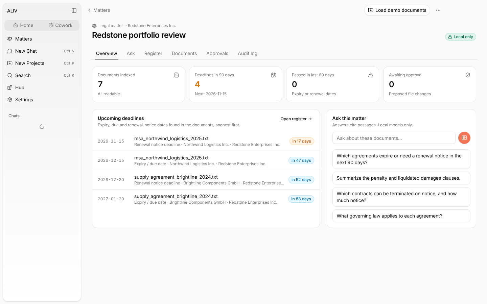
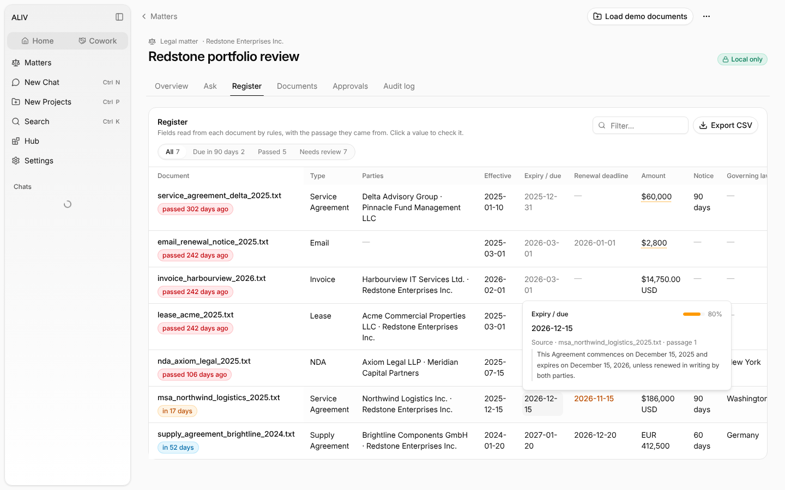

<div align="center">

# ALIV

### Autonomous Local Intelligence Vault

**A local-first AI workspace for legal and finance teams.**<br/>
Client documents are indexed on your own computer. Answers cite their sources, file changes wait for your approval, and every model call is recorded in a tamper-evident audit log.

<br/>

[](apps/desktop/LICENSE)
[](https://tauri.app)
[](https://www.rust-lang.org)
[](https://react.dev)

[🚀 Build and run](#build-and-run) &nbsp;·&nbsp; [📚 Product docs](docs/README.md) &nbsp;·&nbsp; [📖 User guide](docs/user-guide.md) &nbsp;·&nbsp; [🔒 Security](docs/security.md) &nbsp;·&nbsp; [🛠️ Developer guide](docs/developer.md) &nbsp;·&nbsp; [🗺️ Plan](docs/PLAN.md) &nbsp;·&nbsp; [📊 Market research](docs/MARKET_RESEARCH.md)

<br/>



</div>

---

## Why ALIV?

Legal and finance teams hold thousands of confidential documents (NDAs, leases, service agreements, invoices) that often can't be sent to a cloud AI without breaching client confidentiality or compliance rules. ALIV keeps them on the user's machine by default, and when a matter's policy allows a cloud model, it sends only the passages a question needs and logs every call.

## What it does

- **Matters.** One private vault per client engagement, typed Legal or Finance, with a model policy:
  - **Local only** (default): passages never go to a cloud model.
  - **Hybrid**: cloud models are allowed, but only the matching passages are sent, and every call is logged.
- **Ingestion.** Point a matter at folders. PDF, DOCX, XLSX, PPTX, HTML, TXT/MD and EML files are parsed on the device and indexed. Scanned PDFs and images are read with OCR (Tesseract). Unchanged files are skipped.
- **Register.** Parties, dates, renewal-notice deadlines, amounts, notice periods, governing law and penalty clauses are extracted. Every value links to the passage it came from, with a confidence score.
- **Ask.** Passages are found by keyword and, with the local embedding model, by meaning, so "can we exit early?" finds a termination-for-convenience clause. Answers cite numbered sources you can open. Deadline questions are answered straight from the register, with no model needed.
- **Policy gate.** Every model call is checked in Rust first. A cloud model on a Local only matter is refused, and the refusal is logged.
- **Approvals and undo.** Proposed file renames change nothing on disk until approved, never overwrite files, and can be undone.
- **Audit log.** Ingestion, policy changes, model calls, proposals and file changes are recorded in a SHA-256 hash chain with a one-click integrity check.
- **Agent and CLI.** The `aliv` command-line agent and an embeddable agent protocol. See the [agent cookbook](apps/desktop/docs/agent/adk-cookbook.md).



## Build and run

The app lives in [`apps/desktop`](apps/desktop/README.md). It needs Node 22 and Rust (the version is pinned in `apps/desktop/rust-toolchain.toml`).

```bash
cd apps/desktop
corepack enable
yarn install
yarn build:tauri:plugin:api && yarn build:core && yarn build:extensions
yarn dev          # desktop app
yarn dev:web      # browser preview with demo data at /matters/
```

Platform prerequisites, tests and the repository layout are in the [app guide](apps/desktop/README.md).

## Repository

| Path | What |
|---|---|
| [`apps/desktop/`](apps/desktop/README.md) | **The ALIV app**: Tauri 2 desktop app, matter vault plugin, `aliv` CLI, React UI |
| `demo/corpus/` | Sample legal and finance documents used by the demo and tests |
| [`benchmarks/`](benchmarks/README.md) | Labelled corpus and the script that scores the vault's extraction |
| `docs/` | [User guide](docs/user-guide.md), [security and privacy](docs/security.md), [developer guide](docs/developer.md), [plan](docs/PLAN.md), [market research](docs/MARKET_RESEARCH.md), [customer one-pager](docs/CUSTOMER_ONE_PAGER.md), [strategy](docs/ALIV_FUTURE_STRATEGY.md) |

## License

The ALIV app is licensed under Apache-2.0 and builds on Apache-2.0 open-source software. See [`apps/desktop/LICENSE`](apps/desktop/LICENSE) and [`THIRD_PARTY_NOTICES.md`](apps/desktop/THIRD_PARTY_NOTICES.md).

<div align="center">

Built by [Venkata Anil Kumar](https://github.com/VenkataAnilKumar)

</div>
