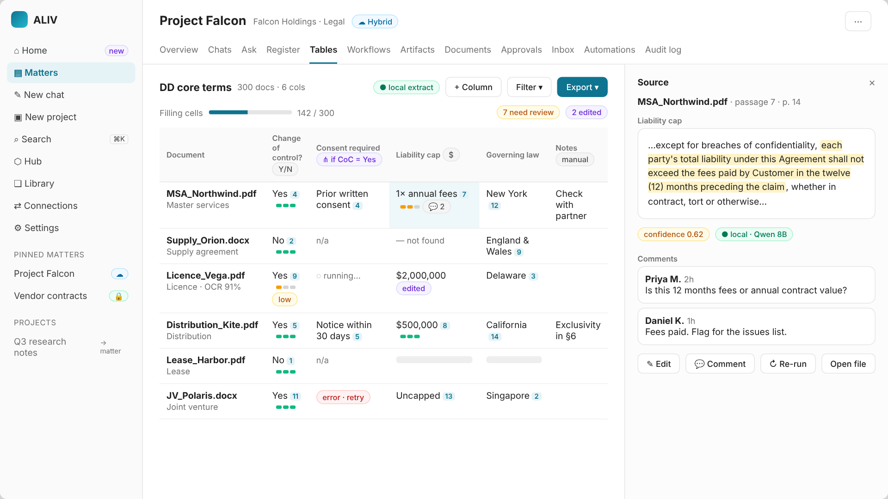
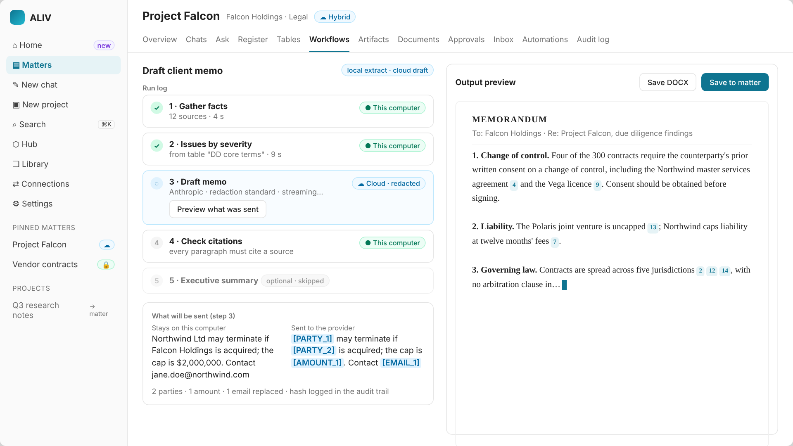
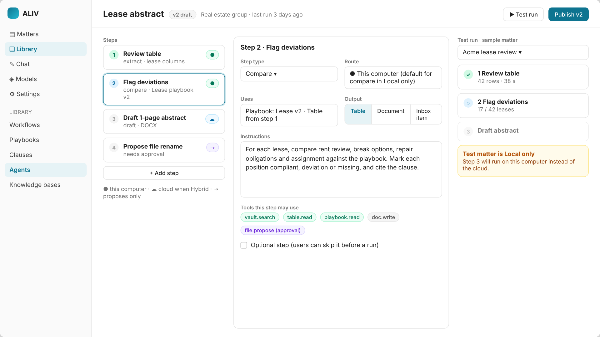
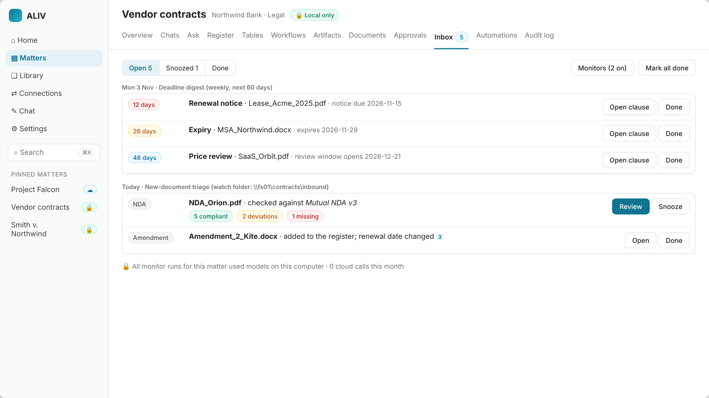
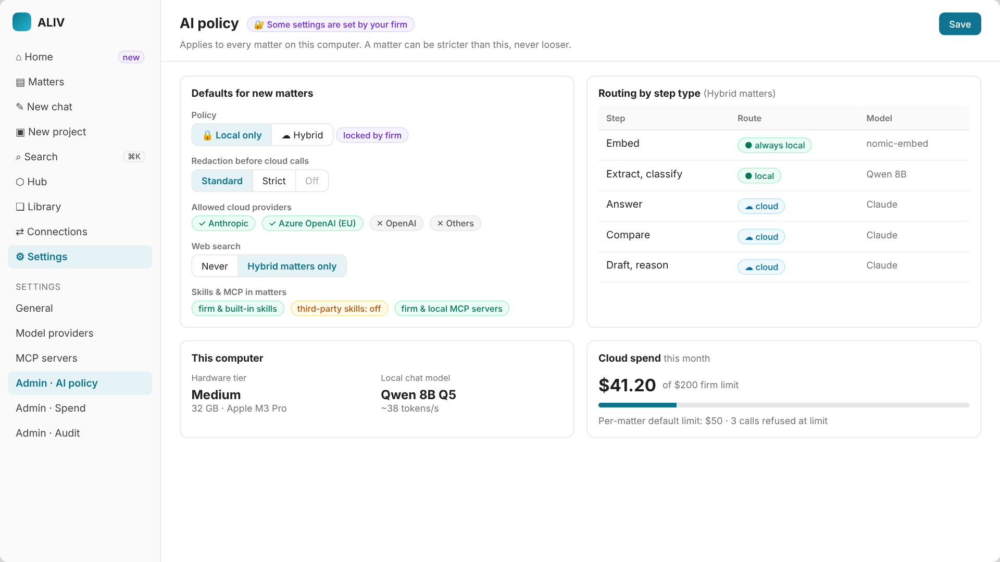
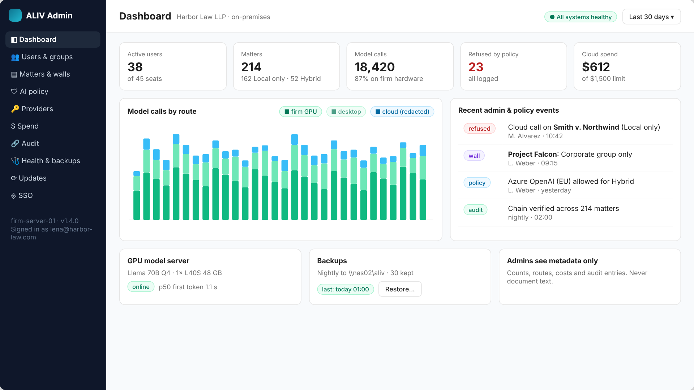

# Wireframes
## Key screens, current and planned

**Version:** 1.0 | **Date:** October 29, 2026 | **Status:** Active

Low-fidelity layouts for the [UI Spec](ALIV_UI-Spec.md). ✅ marks shipped screens (see the screenshots in `docs/assets/`). The others are planned.

## High-fidelity mockups

Rendered with the app's design tokens ([Design System](ALIV_Design-System.md)). These are **mockups of planned screens**, not screenshots; the data is fictional.

| Screen | Release | Image |
|---|---|---|
| Home: one view across all matters (W-0) | R1–R3 |  |
| Review table with source drawer (W-5) | R2 |  |
| Workflow run with redaction preview (W-7, W-8) | R1–R2 |  |
| Agent Builder (W-10) | R3 |  |
| Inbox (W-11) | R3 |  |
| Admin settings on the desktop (W-13) | R1 |  |
| Firm Server Admin Console (W-14) | R4 |  |

---

## W-0 Home (R1–R3)

The landing screen once tables, workflows and monitors exist. It shows:
- a greeting;
- a quick Ask box with a matter picker and its route pill;
- four counters: deadlines in 30 days, waiting for you, running now, model calls this month with the local share;
- upcoming deadlines across all matters;
- "Waiting for you": approvals, inbox items, cells needing review;
- running tables and workflows with progress.

Pinned matters sit in the sidebar with their policy icon. See the [mockup](../assets/mockups/home.png). Until R1, the Matters home (W-1) is the landing screen.

## W-1 Matters home ✅

```
┌──────────────────────────────────────────────────────────────────────────────┐
│ ALIV                                           [Vault health]  [+ New matter] │
├──────────────────────────────────────────────────────────────────────────────┤
│ Matters                                                                      │
│ Each matter is a private vault…                                              │
│                                                                              │
│ Upcoming deadlines (90 days)                                                 │
│  [12 days] Renewal notice · Lease_Acme_2025-03-01.pdf · Acme lease review     │
│  [31 days] Expiry · MSA_Northwind.docx · Vendor contracts                    │
│                                                                              │
│ ┌──────────────────────┐ ┌──────────────────────┐ ┌──────────────────────┐   │
│ │ ⚖ Acme lease review  │ │ ⚖ Project Falcon     │ │ ▣ AP Q4              │   │
│ │ Redstone Inc.        │ │ Falcon Holdings      │ │ Finance              │   │
│ │ 🔒 Local only        │ │ ☁ Hybrid             │ │ 🔒 Local only        │   │
│ │ 42 docs · 3 pending  │ │ 312 docs             │ │ 180 docs             │   │
│ └──────────────────────┘ └──────────────────────┘ └──────────────────────┘   │
└──────────────────────────────────────────────────────────────────────────────┘
```

## W-2 Ask ✅ (with R1 RoutePill)

```
┌─ Acme lease review  🔒 Local only ─────────────────────────────────────── ⋯ ┐
│ Overview Chats [Ask] Register Tables Workflows Artifacts Documents Approvals… │
├───────────────────────────────────────────────┬──────────────────────────────┤
│ [Model: Qwen 8B ▾]        (● This computer)   │ Sources                      │
│ ┌───────────────────────────────────────────┐ │ ┌──────────────────────────┐ │
│ │ Ask a question about this matter…   @  [➤]│ │ │[1] Lease_Acme.pdf  p.4   │ │
│ └───────────────────────────────────────────┘ │ │ "Tenant must give notice │ │
│                                               │ │  no later than 60 days…" │ │
│ Q  Which leases renew in 90 days?             │ ├──────────────────────────┤ │
│ A  Two leases renew before 2027-01-01:        │ │[2] Lease_Beta.pdf  p.2   │ │
│    • Acme: notice due 2026-11-02 [1]          │ │ …                        │ │
│    • Beta: notice due 2026-12-15 [2][3]       │ ├──────────────────────────┤ │
│    Qwen 8B · llamacpp · local · 5 sources     │ │[3] register · Lease_Beta │ │
│    Found by keyword and by meaning.           │ └──────────────────────────┘ │
│    [Save as DOCX]  (R2)                       │                              │
└───────────────────────────────────────────────┴──────────────────────────────┘
```

## W-3 Register ✅

```
│ [All 42] [Due in 90 days 5] [Passed 2] [Needs review 4]          [Export CSV] │
│ Document              Type     Parties            Expiry      Notice   Penalty│
│ Lease_Acme_2025.pdf   Lease    Acme · Redstone    2026-03-01  60 days  ✓      │
│ NDA_Meridian.pdf      NDA      Axiom · Meridian   2026-07-15  —        ✓      │
│   └ click a cell → source passage drawer                                      │
```

## W-4 Documents ✅

```
│ Documents   38 indexed · 4 not readable. Search matches by keyword and meaning│
│ Name / summary                                  Type   Status           Pass. │
│ Lease_Acme_2025.pdf                             Lease  [indexed]         12   │
│  Lease between Acme… Effective 2025-03-01; …                                  │
│ scan_017.jpg                                    NDA    [indexed][OCR 91%] 3   │
│ protected.pdf                                   —      [protected]       0    │
```

## W-5 Review table (R2)

```
┌─ Project Falcon  ☁ Hybrid ─────────────────────────────────────────────── ⋯ ┐
│ Tables › DD core terms                     (● local extract) [Run ▸][Export▾]│
│ [+ Column] [Template▾] [Filter: needs review ▾] [Group ▾]   142/300 cells ▓▓░ │
├──────────────────────┬───────────────┬──────────────┬──────────────┬─────────┤
│ Document             │ Change of     │ Consent      │ Liability    │ Notes ✎ │
│                      │ control? (Y/N)│ required? ⋔  │ cap ($)      │ (manual)│
├──────────────────────┼───────────────┼──────────────┼──────────────┼─────────┤
│ MSA_Northwind.pdf    │ Yes [4] ▮▮▮   │ Prior written│ 1x fees [7]  │ check   │
│                      │               │ consent [4]  │ ▮▮▯ 💬2      │         │
│ Supply_Orion.docx    │ No  [2] ▮▮▮   │ n/a          │ — not found  │         │
│ Lic_Vega.pdf         │ Yes [9] ▮▯▯ ⚠ │ ◌ running…   │ $2,000,000 ✱ │         │
│ …                    │               │              │  (edited)    │         │
└──────────────────────┴───────────────┴──────────────┴──────────────┴─────────┘
  ⋔ conditional column (runs where Change of control = Yes)   ⚠ low confidence
  Click any cell → SourceDrawer (passage highlighted · edit · comment · re-run)
```

## W-6 Add column (R2)

```
┌ Add column ───────────────────────────────────────────┐
│ Question  [Is there a cap on liability? If so, amount]│
│ Answer    (•) Amount  ( ) Yes/No  ( ) Date  ( ) Text  │
│           ( ) List    ( ) Classification [options…]   │
│ Only when [Change of control ▾] [= Yes ▾]  (optional) │
│ Route     ● This computer (extract)                   │
│ Preview on 3 rows:                                    │
│   MSA_Northwind   1x fees [7]                         │
│   Supply_Orion    not found                           │
│   Lic_Vega        $2,000,000 [3]                      │
│                               [Cancel] [Add & run all]│
└───────────────────────────────────────────────────────┘
```

## W-7 Workflow run (R2)

```
│ Workflows › Draft client memo                                    [Save DOCX]│
│ Run log                                     │ Output preview                 │
│ ✓ 1 Gather facts       ● local   12 src 4s  │ MEMORANDUM                     │
│ ✓ 2 Issues by severity ● local    8 src 9s  │ To: [Client]                   │
│ ◌ 3 Draft memo         ☁ cloud·redacted     │ Re: Project Falcon diligence   │
│     [Preview what was sent]                 │ 1. Change of control [4][9]…   │
│ ○ 4 Citations check    ● local              │                                │
```

## W-8 Redaction preview (R1)

```
┌ What will be sent to Anthropic · Claude (redaction: standard) ───────────────┐
│ Original (stays here)                │ Sent                                  │
│ Northwind Ltd may terminate if       │ [PARTY_1] may terminate if            │
│ Falcon Holdings is acquired; the     │ [PARTY_2] is acquired; the            │
│ cap is $2,000,000.                   │ cap is [AMOUNT_1].                    │
│ Contact jane.doe@northwind.com       │ Contact [EMAIL_1]                     │
│                         3 parties · 1 amount · 1 email replaced  [Cancel][Send]│
└──────────────────────────────────────────────────────────────────────────────┘
```

## W-9 Playbook result (R2)

```
│ NDA_Meridian.pdf  ·  Playbook: Mutual NDA v3                [Export redlines]│
│ Position                 Result        Evidence           Suggested redline  │
│ Term ≤ 3 years           ✓ compliant   §8 [2]                                 │
│ Residuals clause         ✗ deviation   §5.3 [4]           Delete §5.3 [Apply]│
│ Non-solicit              ! missing     —                  Insert clause [Add]│
│ Governing law: NY        ✗ deviation   §12 [6] (Delaware) Replace… [Apply]   │
```

## W-10 Agent Builder (R3)

```
│ Agents › Lease abstract v1 (draft)                      [Test run] [Publish] │
│ Steps                 │ Step 2: Flag deviations               │ Test run     │
│ 1 Review table  ●     │ Type     [Compare ▾]   Route: ● local │ Matter [▾]   │
│ 2 Flag deviations ●   │ Uses     Playbook: Lease v2           │ ✓ 1  4s      │
│ 3 Draft abstract ☁    │ Instr.   [Compare each lease to…]     │ ◌ 2 …        │
│ 4 Propose rename ⇢    │ Output   (•) Table ( ) Doc            │              │
│ [+ Add step]          │ [ ] Optional step                     │              │
│ ⇢ = proposes only (needs approval)                                            │
```

## W-11 Inbox (R3)

```
│ Inbox                                                [Mark all done]         │
│ Mon 3 Nov · Deadline digest                                                  │
│   [12 days] Renewal notice · Lease_Acme [clause]                    [Done]   │
│   [26 days] Expiry · MSA_Northwind [clause]                          [Done]   │
│ Today · New-document triage                                                  │
│   NDA_Orion.pdf → NDA · 2 deviations (Mutual NDA v3)   [Open] [Snooze]       │
```

## W-12 Matter settings (R1)

```
┌ Matter settings ──────────────────────────────────────┐
│ Policy        ( ) Local only   (•) Hybrid             │
│ Redaction     (•) Standard  ( ) Strict  ( ) Off ⚠     │
│ Cloud limit   [$50] per month                         │
│ Routes        Extract  ● local     Answer  ☁ cloud    │
│               Draft    ☁ cloud     Compare ☁ cloud    │
│                                        [Cancel][Save] │
└───────────────────────────────────────────────────────┘
```

## W-13 Desktop admin: AI policy (R1)

Settings › Admin for whoever manages the firm's install. Defaults for new matters (policy, redaction, allowed providers), routing by step type, hardware tier and local model, and cloud spend. Settings pushed by the firm's policy file (MDM) show as "locked by firm". A matter can be stricter than these defaults, never looser. See the [mockup](../assets/mockups/admin-desktop.png).

## W-14 Firm Server Admin Console (R4)

A browser console: Dashboard, Users & groups, Matters & walls, AI policy, Providers, Spend, Audit, Health & backups, Updates, SSO. The dashboard shows users, matters by policy, model calls by route, calls refused by policy, cloud spend, recent policy events, GPU model server and backups. **Admins see metadata only** (counts, routes, costs, audit entries), never document text. See the [mockup](../assets/mockups/admin-console.png).

## W-15 Matter workspace settings (R1)

```
┌ Project Falcon › Settings › Workspace ────────────────────────────────────────┐
│ Instructions  [We act for the buyer. UK English. Short paragraphs. Flag     ] │
│               [anything affecting completion timing.                       ] │
│ Source folders  \\fs01\deals\falcon\dataroom      scanned 08:02 [Re-scan] │
│                 SharePoint › Falcon DR (connector)  synced 07:55   [Sync]    │
│ Output folder   \\fs01\deals\falcon\ALIV Output                [Change] │
├ Skills & tools ───────────────────────────────────────────────────────────────┤
│ Skills   [✓] DD checklist v3      firm      [✓] House memo style v4   firm   │
│          [ ] UK lease abstract v1 firm      [ ] contract-redliner     3rd ⚠  │
│ MCP      [✓] Billing (firm)  tools: log_time ⇢ approval                       │
│          [ ] Web research (third-party)        Web search [✓] (Hybrid only)  │
└───────────────────────────────────────────────────────────────────────────────┘
```

## W-16 Skill review (R1)

```
┌ Enable skill: contract-redliner ─────────────────── source: skills hub (3rd) ┐
│ SKILL.md                                  │ Bundled files                     │
│ name: contract-redliner                   │  redline.py   ⚠ script            │
│ description: Suggest redlines for …       │  clauses.md                       │
│ ## Steps …                                │ Scripts run only with approval,   │
│                                           │ sandboxed, no network.            │
│ Trust: third-party · off by default in matters      [Cancel] [Enable for me] │
└───────────────────────────────────────────────────────────────────────────────┘
```

## W-17 Artifacts tab (R2)

```
│ Artifacts   [All ▾] [Memo] [Table] [Chronology] [Redline]        ⌕ search     │
│ 📄 Client memo: DD findings   v3 · Priya · ☁ redacted · skills: memo style v4  │
│ ▦ DD core terms (XLSX)        v7 · table run · ● local                        │
│ ⇄ NDA_Meridian redlines       v1 · playbook Mutual NDA v3 · ● local           │
│   └ open → document with citations · History (v1–v3) · Diff · Export · Save → │
```

## W-18 Connectors (R3)

```
│ Connections › Connectors                                     [+ Add connector]│
│ iManage (firm-dm.harbor.law)   3 workspaces → 3 matters   synced 07:55  ✓     │
│ SharePoint (Falcon DR)         1 site → Project Falcon    synced 07:55  ✓     │
│ Outlook (priya@…)              filter "Project Falcon"    token expired ⚠ [Re-auth]│
│ Read-only. Content is indexed on this computer; nothing is written back.      │
```

## W-19 Automations (R3)

```
│ Automations                                                    [+ New]        │
│ ● Morning data-room triage   every weekday 07:30 → agent "DD triage"   on     │
│     last run 07:31 ✓ 6 new docs · 2 inbox items · 0 cloud calls   [History]   │
│ ● NDA inbox                  new email "NDA" → playbook Mutual NDA v3   on    │
│ ○ Weekly invoice check       Mon 06:00 → workflow "Invoice vs contract" paused│
│ Results go to Inbox; changes go to Approvals. Nothing is applied automatically.│
```
